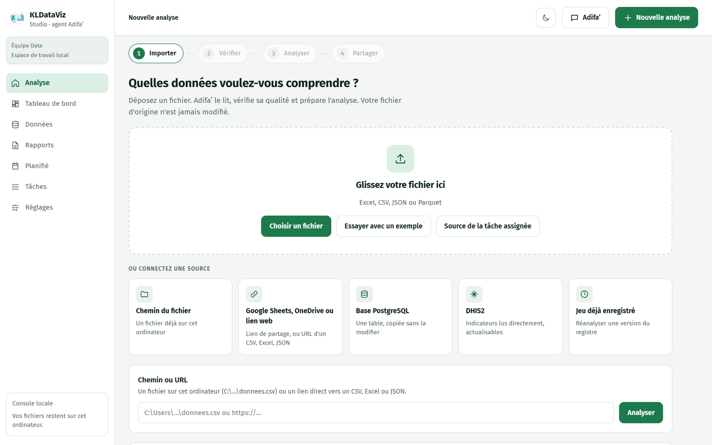
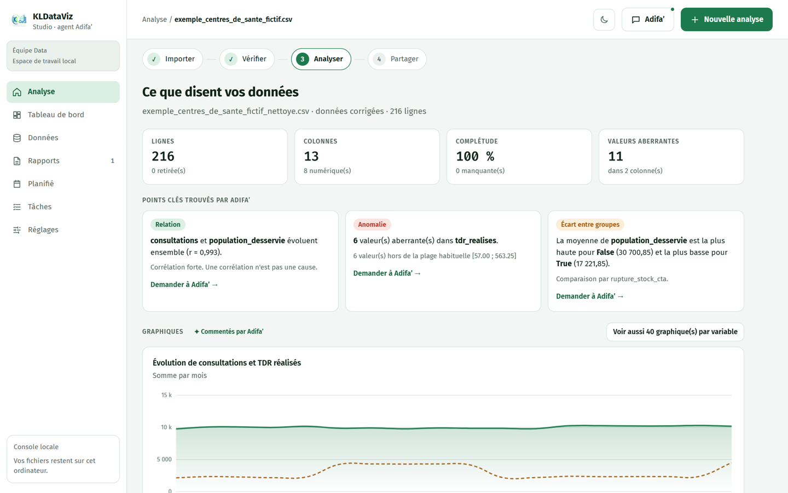
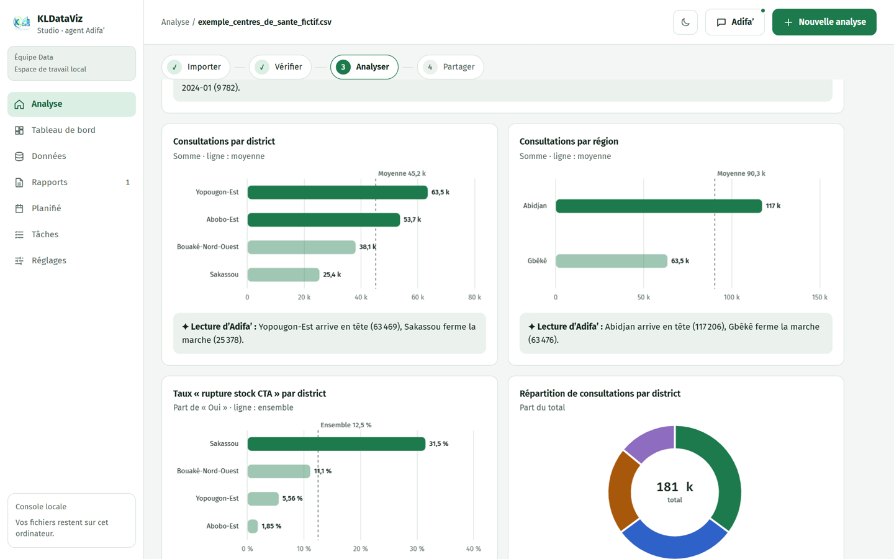
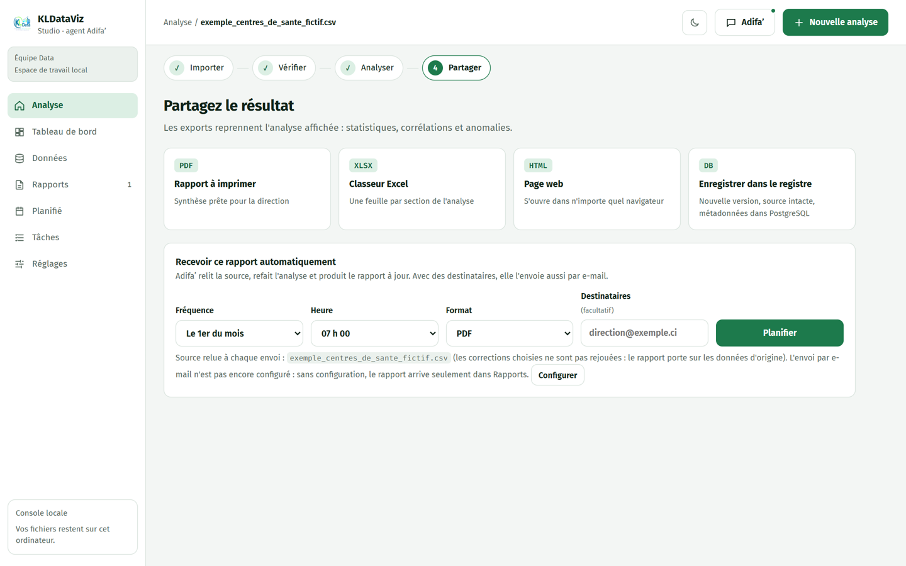
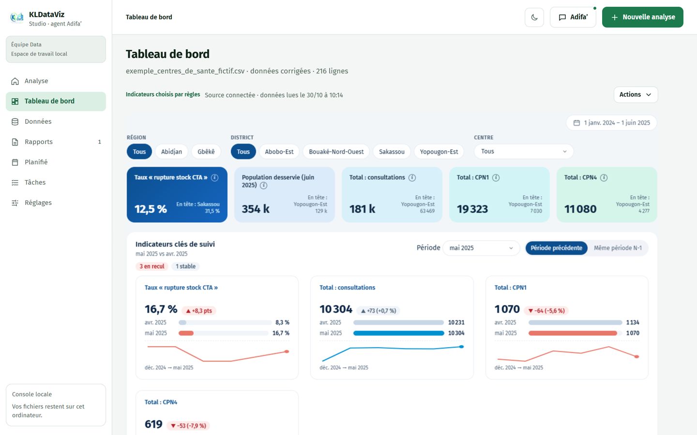

# Guide d'utilisation de KLDataViz

KLDataViz transforme vos fichiers de données en analyses, graphiques, tableaux de bord et rapports, sans Python, sans Power BI et sans formules. Adifa’, son assistante IA, vous accompagne à chaque étape.

**Accès :** [kldataviz.onrender.com](https://kldataviz.onrender.com)

> Toutes les captures de ce guide utilisent le jeu d'exemple fictif intégré à l'application.

## Avant de commencer

1. Ouvrez KLDataViz et créez votre compte avec votre e-mail et un mot de passe.
2. Donnez un nom à votre espace. L'essai gratuit dure 14 jours.

Vous voulez juste découvrir l'outil ? Cliquez sur **Essayer avec un exemple** : un jeu de données fictif (12 centres de santé sur 18 mois) se charge tout seul.

## Les 4 étapes d'une analyse

### 1. Importer

Déposez votre fichier dans la zone prévue : Excel, CSV ou Parquet. Vous pouvez aussi partir d'une source connectée, par exemple Google Sheets, une base PostgreSQL, DHIS2 ou un lien web.

Si votre classeur Excel contient plusieurs feuilles, cochez celles qui vous intéressent.

### 2. Vérifier

Adifa’ examine le fichier et affiche :

- un **score de qualité** sur 100 ;
- la liste des **corrections proposées**, que vous activez ou désactivez une par une ;
- une **structure recommandée**, si le fichier n'est pas au bon format pour l'analyse.

Rien n'est appliqué sans votre accord. Les corrections se font sur une copie : votre fichier d'origine reste intact.

Cliquez ensuite sur **Appliquer les corrections et analyser**.

### 3. Analyser

Vous obtenez les chiffres clés, les points importants (relations, anomalies, écarts entre groupes) et des graphiques commentés en français.

**Posez vos questions à Adifa’.** Cliquez sur le bouton **Adifa’** en haut à droite et écrivez comme à un collègue, par exemple : « Quel district a le plus de cas confirmés en 2025 ? ». Elle calcule la réponse sur vos données, et **Voir le calcul** vous montre comment elle l'a obtenue.

### 4. Partager

Exportez le résultat en PDF, en classeur Excel ou en page web, ou enregistrez-le dans le registre.

Vous pouvez aussi **planifier un rapport automatique** : choisissez la fréquence, l'heure et le format. Si vous ajoutez des destinataires et que l'envoi par e-mail est configuré, le rapport leur est envoyé.

## Le tableau de bord

Dans le menu de gauche, ouvrez **Tableau de bord**. KLDataViz le construit à partir des données analysées : indicateurs, comparaison entre périodes, graphiques et filtres.

Survolez l'icône **ⓘ** d'un indicateur pour savoir **comment ce chiffre est calculé**.

Le menu **Actions** permet de le partager par un lien que vos collègues ouvrent sans compte. Ce lien expire et peut être révoqué à tout moment.

## Travailler en équipe

Chaque espace a trois rôles :

| Rôle | Ce qu'il peut faire |
|---|---|
| Propriétaire | Tout, y compris inviter des membres, exporter ou supprimer les données de l'espace |
| Analyste | Importer, analyser, créer des tableaux de bord et des liens de partage |
| Lecteur | Consulter |

## Vos données

- Chaque organisation dispose d'un espace séparé.
- Le propriétaire peut exporter toutes les données de l'espace ou les supprimer définitivement, depuis **Réglages**.
- N'importez que des données que vous avez le droit de traiter. Pour des données de santé, retirez les informations qui identifient les patients.

## Si quelque chose ne marche pas

| Situation | Que faire |
|---|---|
| Le fichier est refusé | Vérifiez son format et sa taille (25 Mo maximum en ligne). |
| « Adifa’ n'a pas répondu à temps » | L'analyse continue avec des règles automatiques. Réessayez un peu plus tard pour obtenir l'avis de l'IA. |
| Le premier chargement est lent | Patientez quelques secondes, puis rechargez la page. |
